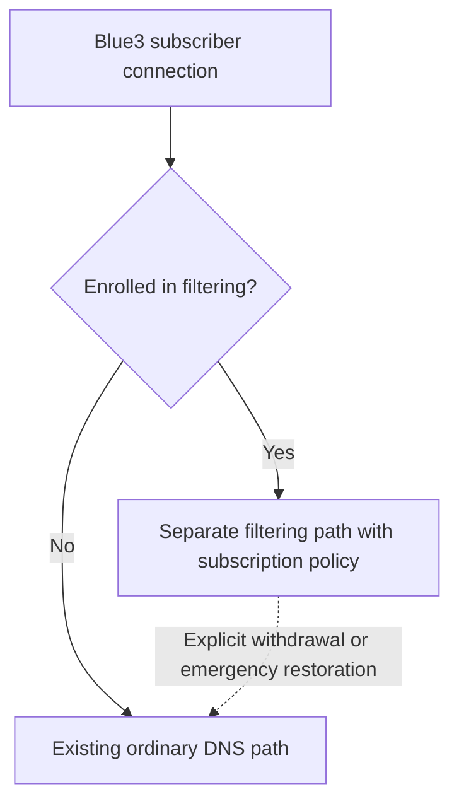

# blue3-dns

> **Status:** `ACTIVE` documentation project · Version **0.1.2**.
> Subscriber architecture and pilot: `PROPOSED`, **2026-11-12**. No implementation.

An architecture proposal and pilot plan for offering DNS filtering to Blue3
Internet subscribers, with NextDNS and iPhone guides as supporting references.
Start with the proposal overview, then review the design and acceptance gates:

| Document | What you will find |
| --- | --- |
| [Blue3 subscriber proposal](docs/blue3.md) | Recommended scope, open decisions, and next steps |
| [Inventory questionnaire](docs/isp-inventory.md) | DNS, CGNAT, IPv6, CPEs, business dependencies, and capacity inputs to collect privately |
| [Architecture](docs/isp-architecture.md) | Query/control paths, CGNAT and IPv6 identity, cache isolation, failures, sizing, and alternatives |
| [Pilot plan](docs/isp-pilot.md) | Phases, test matrix, measurable gates, stop conditions, and rollback |
| [Operations and privacy](docs/isp-operations-privacy.md) | Enrollment, data handling, false positives, support, and ownership |
| [NextDNS guide](docs/nextdns.md) | Service capabilities, limits, plans, and privacy references |
| [NextDNS on iPhone](docs/iphone.md) | Personal-device app/profile reference and verification steps |
| [Documentation index](docs/README.md) | Sources, maintenance, security, and decisions |

This repository contains documentation and repository maintenance tooling.
There is no DNS server implementation or deployment here. Blue3 has not selected
NextDNS through this project, and this is not an official NextDNS project.

## Proposed service



The recommendation is an optional security profile, two equivalent filtering
endpoints in independent failure domains, and a tested return to ordinary DNS.
Subscriber identity must survive CGNAT and IPv6 address changes. Existing
infrastructure, capacity, provider eligibility, and operational ownership still
need validation; the diagram does not describe an operating service.

Filtering covers queries that reach the configured resolver. VPNs, app-specific
DNS, cached answers, and off-network use limit that coverage. Encryption support
depends on the selected transport and client. The initial proposal makes no
universal encryption or parental-control promise. See the
[architecture boundaries](docs/isp-architecture.md#1-service-boundary).

## Getting started

Read the documents on GitHub, or clone them locally:

```bash
git clone https://github.com/samirhvbr/blue3-dns.git
cd blue3-dns
git config core.hooksPath tools/git-hooks
```

No application dependencies, credentials, or runtime installation are required
to read these guides. The pilot is **not started**; proposed numbers are decision
targets, not measurements. See the [source register](docs/sources.md) for dated
technical references and the [open decisions](.continue/README.md) before any
future implementation.

## Contributing

Use English (US), keep claims tied to official sources, and record the date of
verification. Distinguish documented product behavior from device tests or pilot
results. Do not commit configuration IDs, device profiles, credentials, internal
network details, or raw query logs.

Follow [versioning](docs/versioning.md), the [maintenance runbook](docs/runbook.md),
and [security reporting](SECURITY.md). The repository follows the
[samirhvbr/repodocs standard](https://github.com/samirhvbr/repodocs).

## License

[MIT](LICENSE) · Copyright (c) 2026 Samir Hanna Verza.
Third-party product names belong to their respective owners; see [NOTICE](NOTICE).
