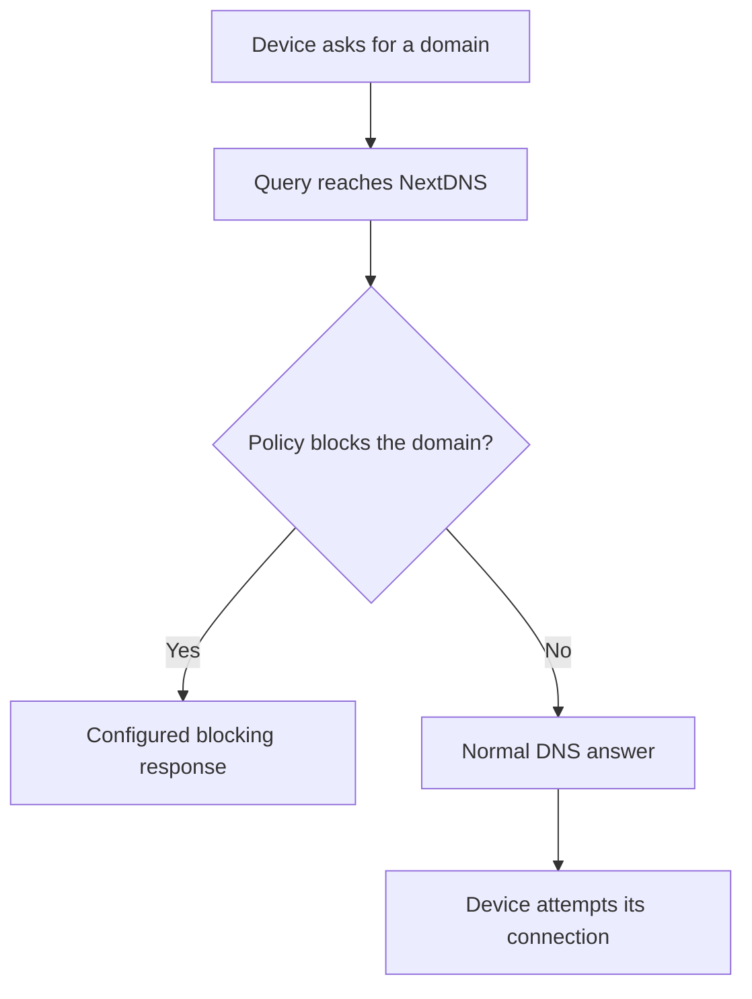

# blue3-dns

> **Status:** `ACTIVE` documentation project · Version **0.1.0**.
> Official product sources last checked on **2026-11-05**.

Reference guides for encrypted DNS, NextDNS, and DNS filtering evaluation at
Blue3. Start with the guide for your use case:

| Document | What you will find |
| --- | --- |
| [NextDNS guide](docs/nextdns.md) | Query flow, capabilities, limits, plans, and privacy |
| [NextDNS on iPhone](docs/iphone.md) | App versus native profile, setup, verification, and rollback |
| [Blue3 evaluation](docs/blue3.md) | Corporate and ISP requirements, trade-offs, and pilot criteria |
| [Documentation index](docs/README.md) | Sources, maintenance, security, and decisions |

This repository contains documentation and repository maintenance tooling.
There is no DNS server implementation or deployment here. Blue3 has not selected
NextDNS through this project, and this is not an official NextDNS project.

## Query flow



Filtering can cover apps and browsers that use the configured resolver. A VPN,
app-specific DNS, or cached answers can change the path. Encrypted DNS protects
queries in transit to the resolver; filtering does not replace endpoint security
or access controls. See the [guide and its sources](docs/nextdns.md).

## Getting started

Read the documents on GitHub, or clone them locally:

```bash
git clone https://github.com/samirhvbr/blue3-dns.git
cd blue3-dns
git config core.hooksPath tools/git-hooks
```

No application dependencies, credentials, or runtime installation are required
to read these guides. Use the [iPhone guide](docs/iphone.md) for a personal device
or the [evaluation framework](docs/blue3.md) before proposing a Blue3 pilot.

## Contributing

Use English (US), keep claims tied to official sources, and record the date of
verification. Distinguish documented product behavior from device tests or pilot
results. Do not commit configuration IDs, device profiles, credentials, internal
network details, or raw query logs.

Follow [versioning](docs/versioning.md), the [maintenance runbook](docs/runbook.md),
and [security reporting](SECURITY.md). The repository follows the
[samirhvbr/repodocs standard](https://github.com/samirhvbr/repodocs).

## License

[MIT](LICENSE) · Copyright (c) 2026 Samir Hanna Verza.
Third-party product names belong to their respective owners; see [NOTICE](NOTICE).
