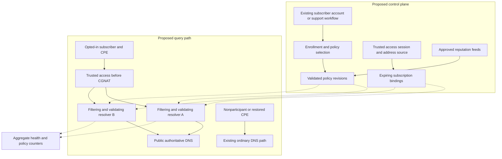

# Subscriber DNS filtering architecture

> **Status:** `PROPOSED` · **2026-11-12**.
> Design for review. No stack, provider, infrastructure, or pilot is approved or
> implemented by this document. All numeric targets are proposed pilot gates.

[Proposal overview](blue3.md) · [Pilot plan](isp-pilot.md) ·
[Operations and privacy](isp-operations-privacy.md)

CPE means the subscriber's router or other customer-premises equipment. NOC
means the network operations team; CGNAT is the provider's shared address translation.

## 1. Service boundary

Offer optional DNS filtering to Blue3 access subscribers. The initial unit of
policy is an **Internet subscription and its connected household**, not an
individual person or application. Recommend starting with a security profile
for known malicious and phishing domains. Keep advertising/tracking categories
as a later, separate opt-in profile because their compatibility trade-offs differ.

The first pilot covers queries that reach the selected Blue3 resolvers through
the subscriber's Blue3 connection. It does not promise protection on a mobile
carrier, another ISP, VPN-supplied DNS, application-specific DNS, direct IP
connections, or previously cached answers. No forced DNS redirection, TLS
inspection, root certificate installation, or parental-control guarantee is
proposed. The existing [NextDNS guide](nextdns.md) explains these general limits.

Authoritative DNS, existing internal zones, and ordinary subscriber resolution
remain separate responsibilities. Identify any required private-name forwarding
before enrollment; never send internal zones to a public upstream by accident.

## 2. Known facts and missing inputs

The owner has selected ISP subscribers as the audience and requested a proposal
without implementation. This repository contains documentation, not evidence
about Blue3's current DNS topology. The following inventory is still unknown:

| Input | Why it changes the design | Evidence owner |
| --- | --- | --- |
| Subscriber count, pilot locations, access methods | Cohort size, routing, and identity coverage | Network operations (NOC) |
| Current resolvers, software, versions, internal zones | Reuse, compatibility, and rollback destination | NOC |
| Location of DNS traffic relative to CGNAT and access realms | Whether a subscription can be identified safely | Access network owner |
| Session/address source and IPv6 prefix delegation lifecycle | Binding creation, revocation, and address reuse | Access network owner |
| CPE models, firmware, DHCP/RA behavior, management channel | Activation, IPv6 coverage, and restoration time | CPE operations |
| Measured QPS, cache hit rate, latency, CPU/memory, failure domains | Capacity and availability budget | NOC |
| Available operators, support hours, budget, vendor terms | Whether self-operation is sustainable | Service owner |

Collect operational values in a private inventory. Publish only a sanitized
decision summary here. The cohort sizes in the pilot plan are planning limits,
not estimates of Blue3's subscriber base.

## 3. Recommended topology

Evaluate a **separate Blue3-operated filtering resolver pool**, reachable before
subscriber identity is lost to CGNAT. Keep the current ordinary DNS path available
for nonparticipants, withdrawal, and explicit emergency rollback. Use established
resolver/filtering components; do not build a recursive resolver.

The diagram shows the self-operated option. A contracted managed resolver would
replace the resolution/filtering backend; it is an alternative to evaluate, not
an additional fallback selected by this drawing. Ordinary DNS may have existing
policies of its own; inventory them rather than assuming it is unrestricted.

| Component | Proposed responsibility |
| --- | --- |
| Enrollment | Reuse account authentication and subscription ownership from an existing Blue3 system; a reviewed support ticket is sufficient for a small pilot |
| Access binding | Convert an authoritative active session/lease into an expiring subscription-to-address/prefix mapping |
| Query ingress | Restrict authorized source networks, preserve access realm, select the correct policy, and limit abuse |
| Resolver and policy engine | Cache and validate DNS; enforce the effective policy on every relevant response path |
| Policy publication | Validate feeds and overrides, publish immutable revisions, and retain the previous working revision |
| Monitoring | Measure resolution and filtering independently, without a browsing-history dashboard |

These are logical responsibilities, not six new services. Combine them using
existing capabilities where possible. Add a dispatcher or integration service
only if the selected stack cannot meet the identity and isolation tests without
it. Neither a new subscriber portal nor a billing integration is needed to prove
the initial service.

Resolver A and B need independent failure domains: assess power, hypervisor,
uplink, routing, and storage. Two VMs on one host are not that evidence. Every
advertised endpoint must implement the same subscriber policy; clients must not
be assumed to use a strict primary/backup order. Do not advertise an ordinary
resolver alongside a filtering resolver as a routine backup.

## 4. Identity under CGNAT and IPv6

Identify the subscription at a trusted point before carrier NAT, using the
assigned WAN IPv4 address and access realm, or the delegated IPv6 prefix and its
active assignment. Private addresses may overlap between realms. An IPv6 device
address must belong to the current delegated prefix; temporary device addresses
do not require individual household identities.

AAA/RADIUS, DHCP, PPPoE session records, or the existing access controller are
candidate sources, subject to inventory. A shared public IPv4 address is not a
subscriber identifier. A CPE forwarding DNS must still leave enough trusted
context to distinguish subscriptions; an ISP-wide proxy that collapses them
into one source address does not.

The conceptual binding contains only a pseudonymous subscription reference,
access realm, address/prefix, session generation, validity interval, enrollment
revision, and effective policy revision. It is a design contract, not a database
schema to implement now.

Required lifecycle properties:

1. Authenticate the binding source and reject expired or out-of-order updates.
2. Replace assignments atomically. Revoke the previous binding before an address
   or prefix can select policy for its new holder; cover delayed disconnects,
   reconnects, overlapping prefixes, and out-of-order events.
3. Prove how reuse is fenced. A cached lease or periodic polling alone is not
   proof: an early reassignment can occur before its expiry. Require reliable
   coordination with assignment or trusted current-session context. If neither
   is available, this identity model cannot pass the subscriber pilot gate.
4. When identity is missing, ambiguous, or expired, do not apply another
   subscriber's rules. The proposed availability-first behavior is ordinary
   resolution for an otherwise authorized access source, plus a degraded-service
   signal. Unauthorized sources receive no recursion.
5. Do not refresh binding validity just because queries continue arriving. A
   control-plane outage cannot extend an old subscriber's ownership indefinitely.

If traffic is visible only after CGNAT, stop this design path until a trusted
pre-NAT path or supported authenticated CPE transport exists. A hostname, a
guessable configuration identifier, or an arbitrary forwarded header is not
authentication. Off-network access is deferred until a compatible authentication
and revocation model has been tested.

Do not treat client-supplied EDNS Client Subnet (ECS) as identity, and do not send
subscriber prefixes upstream by default. RFC 7871 discusses ECS privacy and
operational trade-offs; it is not a subscriber authentication mechanism.
[Source: RFC 7871](https://www.rfc-editor.org/rfc/rfc7871.html).

## 5. Policies, caching, and DNS correctness

Start with ordinary resolution and one security profile. Exceptions should be
narrow, expire, identify their approver, and affect only the intended scope.
Avoid a global allow rule as a convenient fix for a single subscriber. Treat a
shared security-feed correction separately from a subscriber exception.

Publish immutable, authenticated policy snapshots with a revision, source
provenance, creation time, integrity digest, and expected rule counts. Reject
malformed, unexpectedly empty, expired, or excessively changed updates. Test on
a canary before promotion; retain the last working snapshot. Resolver readiness
must test that the expected policy is loaded, not merely that port 53 answers.

There must be no synchronous portal, billing, or database lookup on each DNS
query. Local policy and still-valid bindings should permit continued operation
during a control-plane outage. After restart, a node without a usable policy
stays out of service until recovered or an explicit degraded mode is authorized.

Separate a cache of original validated DNS data from policy-dependent answers.
If final responses are cached, their key must distinguish the effective policy
revision, including exceptions. Reapply policy on cache hits and invalidate or
partition entries when policy changes. Test positive and negative caching in
both directions between ordinary, filtered, and exception scopes. A CNAME target
must not bypass policy just because the initial name is allowed.

Proposed blocking response: NXDOMAIN for a policy-denied name, with a short
negative-cache lifetime capped at 60 seconds by the policy response, and EDE
`17` (Filtered) when supported for subscriber-requested filtering. EDE explains
an error; it does not change DNS response-code processing or guarantee a browser
message. Test the actual SOA/negative TTL and behavior across query types.
[Source: RFC 8914, section 4.18](https://www.rfc-editor.org/rfc/rfc8914.html#section-4.18).

Continue DNSSEC validation for allowed answers and reject bogus public data.
Never mark a synthesized blocking answer as an authenticated original answer.
Filtering signed names can conflict with independent client validation: BIND's
RPZ defaults and explicit override illustrate why this must be tested, not
assumed. Review DO/CD/AD flags and signed blocked/allowed zones with the exact
candidate engine. Do not disable validation globally to make filtering work.
[Source: BIND response policy documentation](https://bind9.readthedocs.io/en/stable/reference.html#response-policy-zone-rpz-rewriting).

Verify A, AAAA, CNAME chains, HTTPS/SVCB behavior, negative answers, EDNS, large
responses, and TCP fallback. Do not replace HTTPS destinations with a block-page
IP or install a CA to suppress certificate errors. Support should explain a
policy decision through the account/support channel.

## 6. Transport and exposure

The first candidate path is UDP/TCP DNS on the trusted access network, with CPE
distribution of both policy-equivalent resolver endpoints. This does **not**
claim encryption from legacy devices to the resolver. DoH/DoT are optional lab
tracks for compatible CPEs, gated by the same identity and isolation rules;
neither is promised to all subscribers in the initial cohort.

Validate both DHCP-delivered DNS and IPv6 router-advertisement/DHCPv6 behavior
for each CPE family. RFC 8106 specifies DNS information in IPv6 router
advertisements; actual client support and lifetime handling require device
tests. Avoid an unnoticed ordinary IPv6 path beside filtered IPv4.
[Source: RFC 8106](https://www.rfc-editor.org/rfc/rfc8106.html).

Restrict recursion to authorized access sources and enforce source validation.
Apply measured per-subscription/access limits, connection limits, and capacity
protection without treating all customers behind CGNAT as one abusive client.
Do not expose an unauthenticated Internet-wide resolver or forwarding endpoint.
[Source: RFC 5358](https://www.rfc-editor.org/rfc/rfc5358.html).

If encrypted upstream forwarding is selected, verify certificates and define
bootstrap resolution without a circular dependency. Expiration or connection
failure must follow the declared failure policy; silently downgrading to a new
upstream is not an approved behavior.

## 7. Failure behavior to approve

| Failure | Proposed behavior | Limit and required evidence |
| --- | --- | --- |
| One resolver or its uplink fails | Remaining endpoint serves the same policy | Test real CPE/client recovery and full load on the surviving failure domain |
| Portal or policy publisher fails | Freeze changes; use last working policy and only valid, safely fenced bindings | New enrollment stops; binding freshness and policy age remain observable |
| Identity expires or becomes ambiguous | Ordinary resolution for authorized access; flag lost protection | Never reuse a previous holder's policy; do not represent this mode as parental enforcement |
| Feed download or validation fails | Keep the last verified feed; alert on freshness | Proposed stale-feed alert after 24 hours, adjusted to the contracted feed cadence |
| Policy revisions diverge or are incomplete | Stop promotion; restore a common working revision | Recheck both endpoints before resuming; no silent partially filtered rollout |
| Both filtering endpoints fail | NOC restores the captured ordinary DNS configuration | Explicit, disclosed loss of filtering; recovery depends on the tested CPE management path and cache/configuration lifetimes |
| An exception or feed causes false positives | Narrow exception, previous policy, or subscriber withdrawal | Scope the remedy, track expiry, and test from the affected connection |

The recommendation prioritizes connectivity in declared degraded modes. The
owner must approve that trade-off before a pilot. Preserve an independent NOC
restoration path: recovery cannot depend solely on a failed portal or resolver.
The [pilot rollback procedure](isp-pilot.md#6-rollback-proposal) defines the
proposed time target and the evidence required before enrolling customers.

## 8. Capacity and option selection

Size from **measured ingress traffic after existing CPE caching**. Record average
and peak QPS, bursts, cache misses, DNSSEC work, response sizes, and encrypted
connection churn separately. Do not infer production capacity from subscriber
count alone or extrapolate a small pilot without a new load review.

Proposed load gate: each surviving failure domain sustains at least twice the
measured aggregate pilot peak for one hour in an isolated test, while meeting
latency/error gates. Exercise warm caches, cold caches, random-name misses, and
upstream failure without sending load to third parties. Check shared access
links and ordinary DNS capacity as well as resolver CPU and memory.

Before live enrollment, use a documented upper bound from P1 traffic measurements
of the intended cohort, or conservatively the measured access segment if the
cohort cannot be separated. Recalculate with actual pilot peaks after P3 and
before each expansion. A missing baseline is a reason to hold the load gate,
not to invent a per-household QPS estimate.

For monthly volume, use average QPS × 86,400 × billing-period days; use peak QPS
for capacity, not the monthly bill. The private cost sheet should include
compute, independent sites/uplinks, feed licensing, vendor charges, support and
on-call hours, monitoring, and incident handling. No price or hardware estimate
is defensible until the missing inputs and quotes are available.

| Option | Benefit | Cost or deciding constraint |
| --- | --- | --- |
| Separate Blue3-operated pool — recommended for evaluation | Local identity boundary, control of policy and data handling | Requires operational ownership, failure-domain capacity, feed maintenance, and tested subscription integration |
| Contracted managed ISP service | Provider operates more of the backend | Requires ISP/resale permission, adequate policy isolation, contractual data controls, predictable cost, and measured reachability |
| Filtering added directly to the current shared resolver | Potentially fewer components | Larger impact on nonparticipants; consider only after proving policy/cache isolation and independent rollback |

BIND RPZ and Unbound RPZ are candidates if they fit the team's existing stack;
their documentation establishes available mechanisms, not that either satisfies
this complete design. Compare one familiar candidate first, then another only
if a gate fails. No custom DNS engine, Kubernetes, or anycast rollout is proposed.
[Sources: BIND](https://bind9.readthedocs.io/en/stable/reference.html#response-policy-zone-rpz-rewriting),
[Unbound](https://unbound.docs.nlnetlabs.nl/en/latest/topics/filtering/rpz.html).

NextDNS remains a reference, not a selected wholesale supplier. Its published
Pro plan is personal/family, and Business uses employee billing units. Those
plans do not establish authorization for an ISP subscriber offering; require
written commercial confirmation before selecting that route. A free quota that
falls back to ordinary DNS is unsuitable as the pilot's protection guarantee.
[Source: official pricing](https://nextdns.io/pricing).

Revisit the recommendation if pre-NAT identity cannot be fenced, two independent
failure domains or operational staffing are unavailable, or a contracted service
meets the gates at a lower total operating cost. Record the eventual choice in
the [decision log](decisions.md), with measured evidence and remaining limits.
